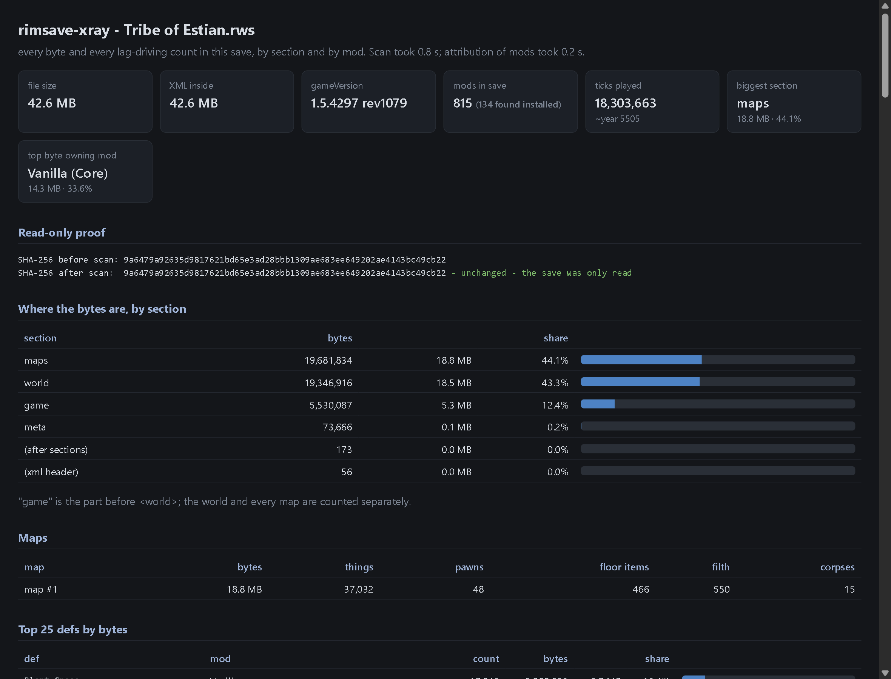
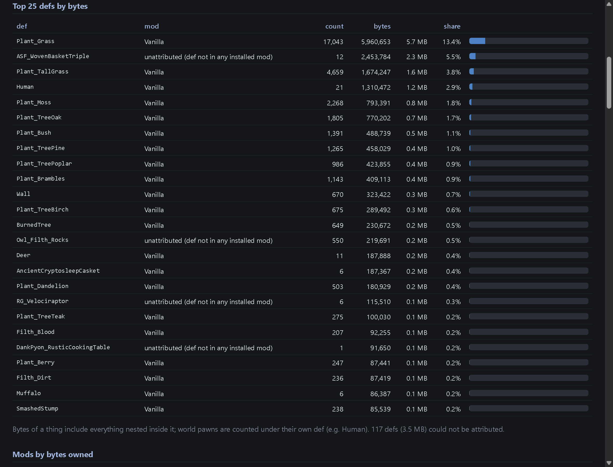

# rimsave-xray

See inside your RimWorld save. A read-only Windows tool that takes one `.rws`
save and tells you where every byte went and what is eating your ticks: a
terminal summary plus a self-contained HTML report, attributing bytes per
section and per mod, with a ranked fix list.

It never writes to the save or the game folder. It prints the save's SHA-256
before and after the scan into the report so you can check.

## The problem it solves

Your autosave is 200 MB and the game hitches when it writes. The usual advice
is "check the save file size" or "disable half your mods", which is an evening
of guessing. The runtime profilers (Dubs Performance Analyzer is the big one)
tell you what code is slow while the game runs, but nothing tells you what is
inside the save itself: which mod's things own the bytes, how many world pawns
are still tracked, how much filth is lying around. rimsave-xray reads the save
file once and answers exactly that.

## Install

You need Windows and RimWorld 1.5+ (1.6 included). The scan itself works on
any RimWorld save back to 1.3.

The easy way is `rimsavexray.exe` from the
[latest release](https://github.com/Booyaka101/rimsave-xray/releases/latest).
It needs nothing else installed. Double-click it and it lists your saves and
asks which one to scan. The exe isn't signed, so Windows SmartScreen may warn
the first time ("More info", then "Run anyway"). If something blocks unsigned
programs outright, the pip install below works around that.

With Python 3.11 or newer from
[python.org](https://www.python.org/downloads/) (tick "Add python.exe to PATH"
in its installer):

```
py -m pip install rimsavexray
```

Then `rimsavexray` runs from anywhere (`py -m rimsavexray` works the same).

## Use it

Point it at a save. A path, a folder, or the in-game save name all work:

```
rimsavexray "Tribe of Estian"
rimsavexray "C:\Users\me\...\Saves\Autosave-1.rws"
rimsavexray "demosave 1.rws.gz"
```

On a 42.6 MB, 815-mod save:

```
save        C:\Users\...\Saves\Tribe of Estian.rws
file size   42.6 MB
gameVersion 1.5.4297 rev1079   ticks 18303663
mods        815 in the save's load order
sections    maps is the biggest at 18.8 MB (44.1% of the save)
top mod     Vanilla (Core) - 14.3 MB (33.6%)
world pawns 27 tracked (6 alive, 21 dead)
map things  37032 on 1 map(s): 466 floor items, 550 filth, 15 corpses

fix list:
 [!] Mod Vanilla (Core) owns 14.3 MB (33.6% of the save) (vanilla content).
 [ ] 6 world pawns still tracked (18 dead, 18 apparel items in their inventories) - within the 800 rule threshold.

read-only   SHA-256 before 9a6479a92635d9817621bd65e3ad28bbb1309ae683ee649202ae4143bc49cb22
            SHA-256 after  9a6479a92635d9817621bd65e3ad28bbb1309ae683ee649202ae4143bc49cb22
report      rimsavexray-report.html
```

The HTML report (written next to the program, `--out` to place it elsewhere)
has the byte bars per section, per map, the Top 25 defs by bytes with the mod
that owns each, every mod by bytes owned, the ranked fix list, and the world
pawn breakdown by faction:





Options:

```
--json        print the full result as JSON (same numbers as the HTML)
--out FILE    where to write the report; --out none skips it
--game PATH   the RimWorld install folder, if Steam isn't findable
--list        list the saves in the game's Saves folder
--open        open the report in the browser when done
```

No argument at all means the newest save, and in the double-clicked exe that
means it asks you first, with sizes and dates.

## How attribution works

The scanner walks the save once with the standard library's streaming XML
parser and never builds a tree, so a 400 MB save parses in well under a minute
using under 50 MB of memory (there is a test that proves it). Every byte
lands in exactly one section (meta, game, world, maps), every map thing and
every world pawn is measured to the byte and attributed to its def.

Def to mod comes from the save itself: the mod list in `meta/modIds` is the
load order, and for every mod there that is installed, the mod's own
`Defs/**/*.xml` files are read for the defNames they define. When two mods
define the same defName, the last one in load order owns it, which is how the
game resolves it too. Core, Royalty, Ideology, Biotech, Odyssey and Anomaly
are grouped as Vanilla. Mods that are not installed are reported as
"unattributed: mod folder not found", and the counts and byte totals stay
exact either way.

Gzipped saves (`.rws.gz`, the format some backup and analysis tools write)
open transparently; byte attribution is on the XML inside, the file size on
disk is shown separately.

## The rules

| rule | fires when | says |
| --- | --- | --- |
| world-pawns | over 800 world pawns outside your faction | how many are tracked, dead, and holding apparel; dev-mode "Clean up world pawns" |
| floor-items | over 20000 items on maps | consolidate or sell |
| filth | over 5000 filth | clean it or use a filth-clearing mod |
| apparel-on-corpses | over 2000 apparel items on dead pawns | strip or destroy corpses |
| save-bytes-by-mod | one mod over 15% of save bytes | which mod owns how many MB |
| autosave-size | file over 150 MB | load time and autosave hitch |

Every message prints the counted number it fired on.

## Limitations

Windows only (the Steam and Saves folder discovery is Windows-shaped; the
scanner itself is pure Python). Runtime-generated defs like `Corpse_Human`
are attributed to the def they wrap (`Human`'s owner). Thing comps are
counted where saves record them; saves rarely record any. The tool is
strictly read-only and is not a mod manager, a save cleaner, or a mod:
it tells you where the weight is, you decide what to do about it.

## Development

```
py -m pip install -e . pytest
py -m pytest                    # everything
py -m pytest -m "not slow"      # skip the 400 MB scale gate
```

The three saves under `tests/fixtures/` are the MIT-licensed demosaves from
[dagpunk/rimhistory](https://github.com/dagpunk/rimhistory/tree/main/test_data).
The save-format paths the scanner relies on (meta, modIds, tickManager,
thing[@Class]/def, worldPawns) were cross-checked against those fixtures and
against real 1.5 and 1.6 saves.

MIT license. If a save of yours doesn't scan, that's a bug: please open an
issue with the save's name, size and gameVersion.
